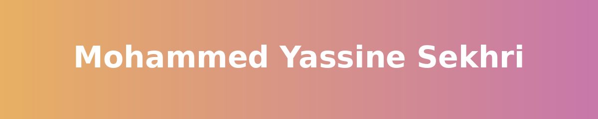

  
  
  

---

## 👨‍💻 About me

- 🎓 MSc student in **Artificial Intelligence & Data Science**, Constantine, Algeria
- 💼 Freelance web designer & developer, building sites for local businesses under **[Nova Web Dz](https://novawebdz.vercel.app/)**
- 🧠 Building AI/ML systems and full-stack web applications
- 🎮 Open-source tinkering, including [OmniPad-PS5](https://github.com/diegobarbosaa/OmniPad-PS5) (bridging an Xbox 360 controller to PS5)
- 🌱 Currently exploring agentic AI, LLM evaluation and IoT with Python

## 🛠️ Tech stack

**Languages & frameworks**

**AI / Data**

**Tools & deployment**

## 🌐 Live websites

| Site | What it is | Live link |
| --- | --- | --- |
| 🏠 Bayt Immobilier | Real estate demo | [bayt-immobilier.vercel.app](https://bayt-immobilier.vercel.app/) |
| 🚗 Cirta Motors | Car dealership demo | [cirta-motors.vercel.app](https://cirta-motors.vercel.app/) |
| 🏛️ Palais El Andalous | Venue demo | [palais-el-andalous.vercel.app](https://palais-el-andalous.vercel.app/) |
| 🏛️ Dar Yemma | Demo site | [dar-yemma.vercel.app](https://dar-yemma.vercel.app/) |
| 💈 Barber 16 | Barbershop demo | [barber-16.vercel.app](https://barber-16.vercel.app/) |
| 💄 Nour Beauty | Beauty salon demo | [nourbeauty.vercel.app](https://nourbeauty.vercel.app/) |
| 🩺 Cabinet Ibtissama | Clinic demo | [cabinet-ibtissama.vercel.app](https://cabinet-ibtissama.vercel.app/) |
| 🏔️ Atlas Iron | Demo site | [atlas-iron.vercel.app](https://atlas-iron.vercel.app/) |
| ✈️ Safa Voyages | Travel agency demo | [safa-voyages.vercel.app](https://safa-voyages.vercel.app/) |
| 👓 MyEyes Center | Optician demo | [myeyes-center.vercel.app](https://myeyes-center.vercel.app/) |
| 👓 Original Eyewear | Optician demo | [original-eyewear.vercel.app](https://original-eyewear.vercel.app/) |
| ⚽ Ronaldinho Store | Football boot store demo | [ronaldinhostore.vercel.app](https://ronaldinhostore.vercel.app/) |

## 🚀 Featured projects

| Project | What it is | Stack | Live link |
| --- | --- | --- | --- |
| **Classe SVT** | Learning platform for a high-school science teacher: courses, quizzes, homework, exams, student logins, chatbot | Next.js, Vercel | [classe-svt.vercel.app](https://classe-svt.vercel.app/) |
| **NextGen Languages** | Website for a language school and IELTS prep | Next.js, Vercel | [nextgen-languages.vercel.app](https://nextgen-languages.vercel.app/) |
| **Personal portfolio** | My portfolio and Nova Web Dz hub | Next.js, TypeScript | [novawebdz.vercel.app](https://novawebdz.vercel.app/) |
| **Agentic video summarizer** | AI system that detects important scenes and builds summaries tailored to the user | Python, LLMs | Private repo, available on request |
| **Flower Classifier** | Deep-learning image classifier for flower species | Python, PyTorch | Private repo, available on request |
| **AeroScan** | Scanning and detection project | Python | Private repo, available on request |

## 🎓 Currently working on

- 🎬 **Agentic video summarization**: an AI system that detects important scenes and produces summaries tailored to the user's needs
- 📡 **AIoT environmental monitoring**: a sensor-based prototype for my MSc coursework
- 📝 **Faithful report generation with LLMs**: research and experiments on keeping generated reports grounded in their sources

## 📊 GitHub stats

  
  

  

  

## 📫 Let's connect

  
  
  

⭐ Thanks for stopping by. Feel free to open an issue or reach out!

